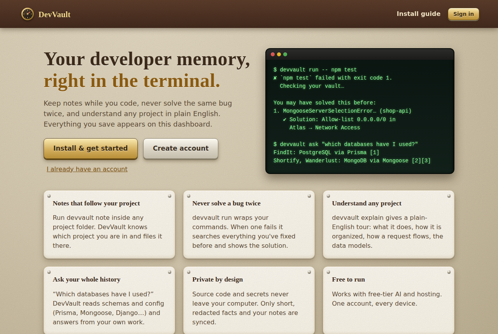
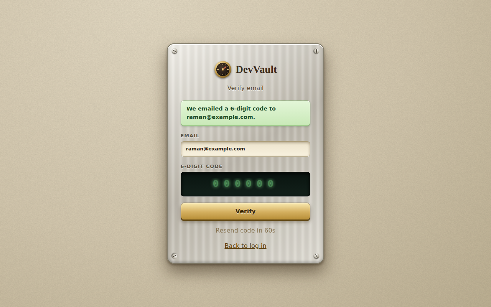
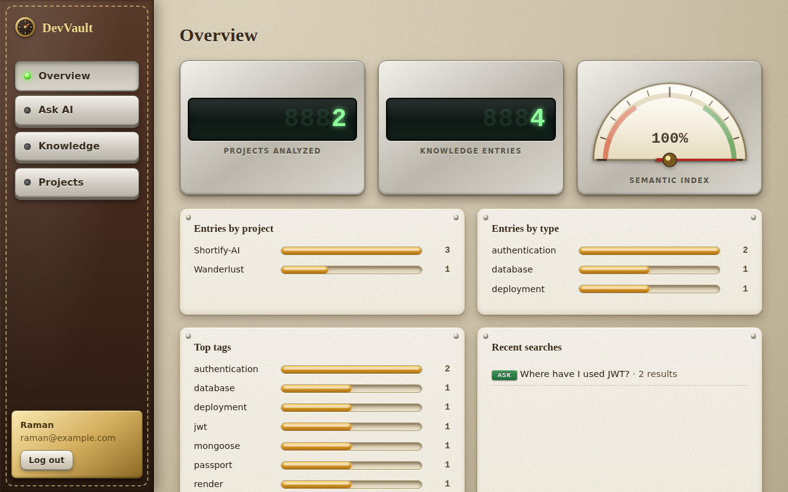
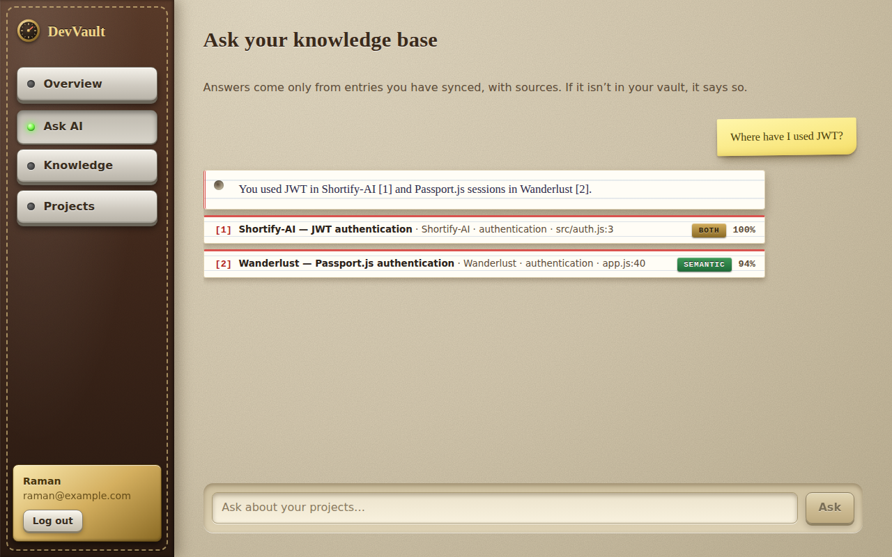
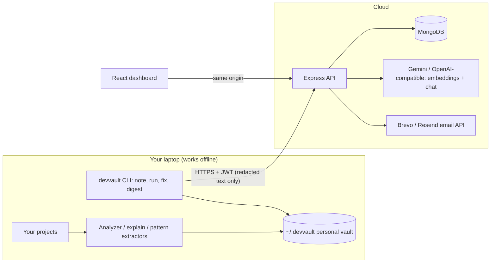

# DevVault

**Your personal developer memory.** Keep notes while you code, never solve the same bug twice, and understand any project in plain English, all from the terminal, across every project you have ever built.

> You hit an error. You *know* you fixed it in an old project but can't remember how. Instead of digging through chats, browser history and old repos:
> ```
> devvault fix "MongooseServerSelectionError: connection timed out"
> ```
> DevVault finds the project where you solved it and prints the solution.

| | |
|---|---|
|  |  |
|  |  |

*(Screenshots use seeded demo data.)*

## Get started (users: no cloning needed)

Your DevVault website has an install guide on its home page. The short version:

```bash
npm install -g https://<your-site>/downloads/devvault-cli.tgz     # needs Node.js 18+
devvault start --api-url https://<your-site>                       # guided: sign up, verify email, done
```

You sign in **once per computer** and stay signed in. Until you do, DevVault commands are locked so everything you save lands in the right account and shows up in your dashboard. On a new computer, install the CLI and run `devvault login`.

## How you use it every day

DevVault follows you from project to project. It detects which project you are in from the folder (nearest `.git` / `package.json`), so notes land in the right place automatically, and everything syncs to your dashboard.

```bash
cd my-new-project
devvault note "Use cursor pagination, offset gets slow on big tables" --tags db,perf
devvault note "Decided: JWT in httpOnly cookie, not localStorage" --type decision
devvault notes                                  # recent notes for THIS project  (--all for every project)

devvault run -- npm test                        # runs your command normally...
#  ...and if it FAILS, DevVault instantly shows how you solved similar errors in other projects
devvault capture-error --last --solution "Allowed my IP in Atlas"   # save the fix once you've found it
devvault fix "ECONNREFUSED 127.0.0.1:27017"     # stuck? search all your past projects for the answer

devvault analyze ../finished-project            # teach DevVault the stack: languages, frameworks, DATABASES, data models, auth, routes
devvault explain ../finished-project            # plain-English tour: what it does, structure, request flow, how to run it
devvault ask "Which databases have I used across my projects?"
devvault digest                                 # auto-write a work log from your recent git commits
```

### How DevVault knows your stack
`analyze` reads **code structure, not just package names**: the Prisma `datasource` provider (so `@prisma/client` becomes "PostgreSQL via Prisma"), Mongoose/Sequelize/TypeORM/Knex/Drizzle configs, Django `DATABASES`, Spring datasources, Docker images, and the scheme of connection URLs (`postgresql://…`; passwords are never read or stored). It also records data models and their fields, and every finding carries its evidence (file and line). `ask` then answers portfolio questions from a per-project technology profile instead of guessing from snippets.


## Features

- **One vault for all projects.** `init` once per user; every project's notes, decisions, bug fixes and overviews live together and are searchable together.
- **Project-aware notes.** Manual notes (`note`), automatic work logs from git (`digest`), automatic error capture (`run`, `capture-error`), and code-derived knowledge (`analyze` + `extract`: routes, auth, databases, env-var names, deployment config).
- **Error memory.** `run -- <command>` wraps any command; on failure it searches your past solutions (offline keyword search + cloud semantic search when logged in) and remembers the error so `capture-error --last` can save the fix in one step.
- **`explain`: understand any codebase.** Detects entry point, folder roles, API routes (with mount prefixes), data models and their fields, auth/security approach, env vars, deployment and how to run it, then writes a plain-English overview with a flow diagram. All local; add `--ai` for a friendlier summary (sends only extracted facts, never code).
- **Grounded AI answers.** `ask` retrieves only *your* entries (hybrid semantic + keyword search) and cites sources. If nothing relevant exists it says so instead of guessing. If the AI provider is down it degrades to keyword matching rather than failing.
- **Real accounts.** Email verification (6-digit code + one-click link), password reset, session invalidation on reset, account deletion, bcrypt + JWT, per-user data isolation, rate limiting.
- **Skeuomorphic web dashboard** (leather, brass, LCD counters, analog gauge) to browse and search your vault, built with only CSS and SVG.
- **Free to run.** Gemini free tier or local Ollama for AI; Brevo free tier for email; MongoDB Atlas free tier; Render free tier.

## Command reference

| Command | What it does |
|---|---|
| `start` | **Guided first-time setup**: connect, sign up/in, verify email. |
| `projects`, `forget <project>` | List projects; remove a project and all its entries (here and in your account). |
| `note "text" [--type --tags --project --general]` | Save a note for the current project. |
| `notes [--all --type]` | List recent notes. |
| `run -- <command>` | Run a command; on failure, show similar past solutions. |
| `fix "<error>" [--file --stdin --local]` | Search past projects for a solution to an error. |
| `capture-error [-m / --file / --stdin / --last] [--solution]` | Save an error + fix. AI structures it when available; works without AI. |
| `digest [--since "7 days ago" --ai]` | Work-log note from git commits. |
| `explain [path\|name] [--out --save --ai]` | Plain-English project overview. |
| `analyze <path>` (also extracts), `extract <id>`, `project`, `architecture`, `map`, `report`, `maintain`, `stats` | Deep project analysis and knowledge extraction. |
| `list`, `show`, `add`, `edit`, `delete`, `search [--semantic]` | Manage and search entries. |
| `register`, `verify`, `login`, `logout`, `forgot-password`, `reset-password`, `account whoami\|delete` | Account. |
| `sync [--dry-run --pull --prune]`, `reindex`, `ask` | Cloud backup, re-embedding, AI Q&A. |
| `config show\|set api-url\|auto-sync`, `vault where\|migrate`, `doctor`, `history`, `export`, `import` | Settings and tools. |

## Developing DevVault itself

```bash
git clone https://github.com/<you>/DevVault && cd DevVault
npm run setup                 # root + backend + dashboard dependencies
npm link                      # `devvault` from your working copy
npm test                      # 200+ tests
```
`devvault: command not found`? See [docs/TROUBLESHOOTING.md](docs/TROUBLESHOOTING.md).


## Run the website/backend yourself

```bash
npm run setup                           # installs root, backend and dashboard dependencies
cp backend/.env.example backend/.env    # fill in MONGODB_URI, JWT_SECRET, AI + email settings
npm run ai:check                        # verifies your AI key (lists valid model names if it fails)
npm run dashboard:build && npm run backend      # http://localhost:5000  (API + dashboard)
```

### AI providers (free options)

| `AI_PROVIDER` | Cost | Needs |
|---|---|---|
| `gemini` | Free tier (rate-limited) | `AI_API_KEY` from https://aistudio.google.com/apikey: one key for chat + embeddings. **Don't set `AI_BASE_URL`** for presets. |
| `groq` | Free tier (no card), very fast | `GROQ_API_KEY` from https://console.groq.com. **Chat only** (Groq has no embeddings): pair with Gemini via `AI_EMBED_PROVIDER=gemini` + `GEMINI_API_KEY`. |
| `nvidia` | Free account (no card), rate-limited, not available in every country | `AI_API_KEY=nvapi-…` from https://build.nvidia.com. OpenAI-compatible; DevVault handles NVIDIA's required `input_type` for embeddings and auto-tries several chat models (availability differs per account). |
| `ollama` | Free, local | Ollama installed; `ollama pull llama3.2 nomic-embed-text`. Backend must run on your machine. |
| `openai` | Paid | `AI_API_KEY` |
| `custom` | varies | `AI_BASE_URL` + model names |

Chat and embeddings may use different providers, and chat can have an automatic **backup provider** (`AI_CHAT_BACKUP_PROVIDER`). Temporary provider errors (503 "high demand") are retried and quota errors (429) switch to another model. Example: `AI_CHAT_PROVIDER=groq` + `AI_EMBED_PROVIDER=gemini` + `AI_CHAT_BACKUP_PROVIDER=gemini`, or `AI_CHAT_PROVIDER=nvidia` + `AI_EMBED_PROVIDER=gemini` with `NVIDIA_API_KEY` / `GEMINI_API_KEY`. After switching the *embedding* provider/model run `devvault reindex`. Models get retired: defaults use stable aliases (`gemini-flash-latest`), and if the configured chat model disappears DevVault tries alternatives automatically and tells you which to pin. `npm run ai:check` tests your key and finds working models. DevVault keeps working (keyword mode) if AI is down or rate-limited.

### Email verification

Render's free tier **blocks SMTP**, so DevVault sends mail over HTTPS APIs: **Brevo** (free, 300/day, no domain needed) or **Resend**. Set `BREVO_API_KEY` + `EMAIL_FROM_ADDRESS` (a sender verified in Brevo). With no provider configured, locally the code prints in the backend terminal; in production verification switches off (with a warning) so nobody gets locked out. Details in `backend/.env.example`.

### Deploy (full guide: [docs/DEPLOY.md](docs/DEPLOY.md))

Push to GitHub → Render **Blueprint** (`render.yaml`) → set `MONGODB_URI`, `AI_API_KEY`, `BREVO_API_KEY`, `EMAIL_FROM_ADDRESS` → allow `0.0.0.0/0` in Atlas Network Access. Docker: `docker compose up --build`. Then everyone runs `devvault config set api-url https://<your-app>.onrender.com`.

## Architecture



## Privacy

| Data | Laptop | Cloud (if you sync) | AI provider |
|---|---|---|---|
| Source code | ✔ stays | never | never |
| Absolute paths | ✔ | no (folder name only) | no |
| `.env` / secrets | never read | never | never (variable *names* only) |
| Notes, extracted knowledge, fixes | ✔ | ✔ (redacted again server-side) | embedding input; top matches as RAG context |
| `explain --ai` facts / `digest --ai` commits | ✔ | n/a | summary of extracted facts / commit messages |

## Security model

bcrypt (cost 12); JWT pinned to HS256 with `tokenVersion`, so a password reset signs out every device; hashed single-use email codes with expiry, a 5-attempt lockout and a resend throttle; no account enumeration on resend/forgot; per-user scoping on every query; type-checked input (no operator injection); size/batch limits; per-route rate limits; Helmet CSP; provider error bodies never echoed to clients; secrets redacted by a shared sanitizer on both CLI and server; account deletion erases all cloud data.

## Testing

`npm test` runs 150+ tests (CLI end-to-end in isolated fake home folders, a mock cloud server, and backend suites with in-memory models covering auth/verification/reset, JWT forgery, user isolation, hybrid ranking, AI degradation, prune/reindex). The dashboard flows were verified in headless Chromium. CI runs on Node 20 and 22.

## Limitations

- Language support for `explain`/extraction is strongest for JavaScript/TypeScript (Python/Java get basic detection).
- Route detection resolves common Express patterns; unusual dynamic routing may be missed.
- Sync is explicit (or `auto-sync`); there is no conflict resolution between devices beyond last write wins by entry id.

MIT
